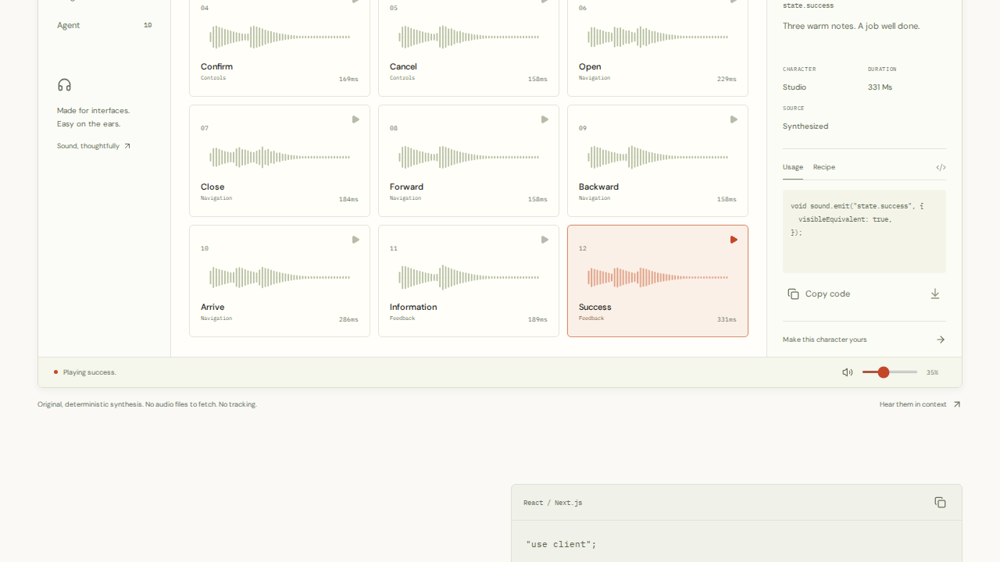

# Initial release evidence

## Implemented and published

Sonant includes the public ESM runtime, React adapter, 32 semantic events, three original themes, copy-in CLI, shared installation configurator, WAV export, source audit hints, recipe checks, provider bridges, local Devtools, interaction examples, and documentation.

- Repository: https://github.com/alvarovillalbaa/sonant
- Website: https://alvarovillalbaa.github.io/sonant/
- npm: https://www.npmjs.com/package/@alvarovillalbaa/sonant/v/0.1.0
- Release: https://github.com/alvarovillalbaa/sonant/releases/tag/v0.1.0
- Initial fully green source: `20b38b95629c5be606e723c060deab42b8203fa0`.
- Expanded 40-check browser run: [38735142788](https://github.com/alvarovillalbaa/sonant/actions/runs/38735142788), source `2edb63615bf369808532d07c0d9c324f908876ea`. Quality and Pages deployment both succeeded.
- Final audio-device repair: [38737386125](https://github.com/alvarovillalbaa/sonant/actions/runs/38737386125), source `0b6e43458e626b61f5da6ff9d351b579bacabebb`. All 25 package checks, 40 browser checks, five additional Firefox cold starts, and Pages deployment succeeded.
- Main-branch confirmation: [38738005948](https://github.com/alvarovillalbaa/sonant/actions/runs/38738005948), source `953040f181328ae9395615726fee4e6b958a4472`. Quality and Pages deployment succeeded again.

## Checks and proof

- `npm run check`: strict package and website TypeScript passed.
- `npm test`: **25 passed**, including actual packed-package installation, executable CLI invocation through npm, generated React source compilation, SSR rendering, deferred device preferences, deterministic recipes, voice budgets, and cancellation during pending unlock/media playback.
- Browser suite: **40 passed** across Chromium, Firefox, WebKit, and mobile Chromium. Covers previews, configuration downloads, visible outcomes, native dialog keyboard behavior, persistent mute, policy traces, exports, iframe bindings, cancellation/disabled controls, unbinding, five-page accessibility checks, and horizontal overflow.
- Repeated Firefox cold starts: **5 passed** in fresh browser workers, with native resume-to-running times of 39–67 ms. The main suite measured 111 ms. No test retries or fake audio renderer were used.
- GitHub Pages: successful deployment and live **HTTP 200**. A separate live Chrome interaction returned `state.success: played` and visible “Playing success.”
- `git diff --check` and staged whitespace checks passed.
- The packed artifact contains 39 files, declarations, preserved client directive, executable CLI, inline public source maps, README, and MIT license. The core has no runtime dependencies.

Screenshots below come from the expanded successful browser run. Browser instrumentation observes native context lifecycle and does not substitute a fake audio renderer.

[Full desktop page](desktop-home.png) · [Mobile page](mobile-home.png)

## Repairs made during verification

Fresh consumer testing caught an npm executable symlink guard that skipped the CLI. Generated-source compilation caught JSON import attributes needed by NodeNext. Browser checks caught contrast, hidden mobile labels, and non-focusable horizontal scrolling. Those were repaired and checked again.

Some headless Firefox cold starts initially remained suspended. The runtime bounds unlock waits and reports blocked playback. Runs [38736212189](https://github.com/alvarovillalbaa/sonant/actions/runs/38736212189) and [38736846411](https://github.com/alvarovillalbaa/sonant/actions/runs/38736846411) each failed the native Firefox preview while the other 39 checks passed. Serial execution did not resolve it. Timestamped native lifecycle evidence measured 1,981 ms between resume and running, beyond the 1,500 ms runtime deadline.

The CI virtual device used PulseAudio's default two-second block. Its supported `norewinds=1` option reduces that block to 50 ms ([upstream implementation](https://github.com/pulseaudio/pulseaudio/blob/master/src/modules/module-null-sink.c)). CI now applies this option and adds five independent Firefox cold-start checks. Run 38737386125 passed all of them. This changes the test device configuration; the published library and its deadline are unchanged. No assertion was removed and no test retry was enabled. Physical audio quality and repeated real-device cold starts remain manual validation.

## Verified registry publication

The initial agent-side publication attempt could not resolve npm's publish endpoint (`ENOTFOUND`), so the reviewed artifact was handed off to the operator. The registry subsequently recorded version **0.1.0** at **2026-10-15 13:02:12 UTC**. Public metadata confirms the MIT license, repository, 39 packaged files, and `latest: 0.1.0`. The temporary `0.0.0-stage` placeholder alone was not counted as publication.

Fresh consumer verification passed in [Registry installation run 38739497019](https://github.com/alvarovillalbaa/sonant/actions/runs/38739497019), source `953040f181328ae9395615726fee4e6b958a4472`, using Node 22.23.3, npm 10.9.9, and pnpm 10.34.7:

- `npm install @alvarovillalbaa/sonant@0.1.0`, installed metadata, core import, and SSR-safe teardown.
- `npx --yes @alvarovillalbaa/sonant@0.1.0 init` and `add sound-settings`, with generated source inspected.
- `pnpm add @alvarovillalbaa/sonant@0.1.0` and `pnpm dlx` init/add, with the selected soft theme and generated async component inspected.

Artifact: `alvarovillalbaa-sonant-0.1.0.tgz`.
SHA-256: `d4c375fb44dd36f0f561216193dd515ea82fbbfa4ef3808c9be93ef9c713a78d`.
Registry integrity: `sha512-ZZsJphSp/Z20lVj6fYka9UrN5hDQroZi4wMP1v7+NepkNe5QVyKRhBu97a888L59rwWpqVHOcVl5Dov93NrqWQ==`.

The actual registry tarball was downloaded with `npm pack @alvarovillalbaa/sonant@0.1.0`; its SHA-256 matches the reviewed local artifact and public GitHub release asset exactly. Every packaged file was also compared byte-for-byte with the local package files after the final CI repair; no differences were found.

## Limits

Automated browser acceptance does not prove physical audibility, real iOS/Android hardware behavior, screen-reader compatibility, perceived loudness, sonic distinctiveness, or improved user outcomes. The auditor is heuristic. Hosted experiments, team governance, native haptics, Ogg export, and direct version-specific external engine adapters are outside this initial local-first implementation.
